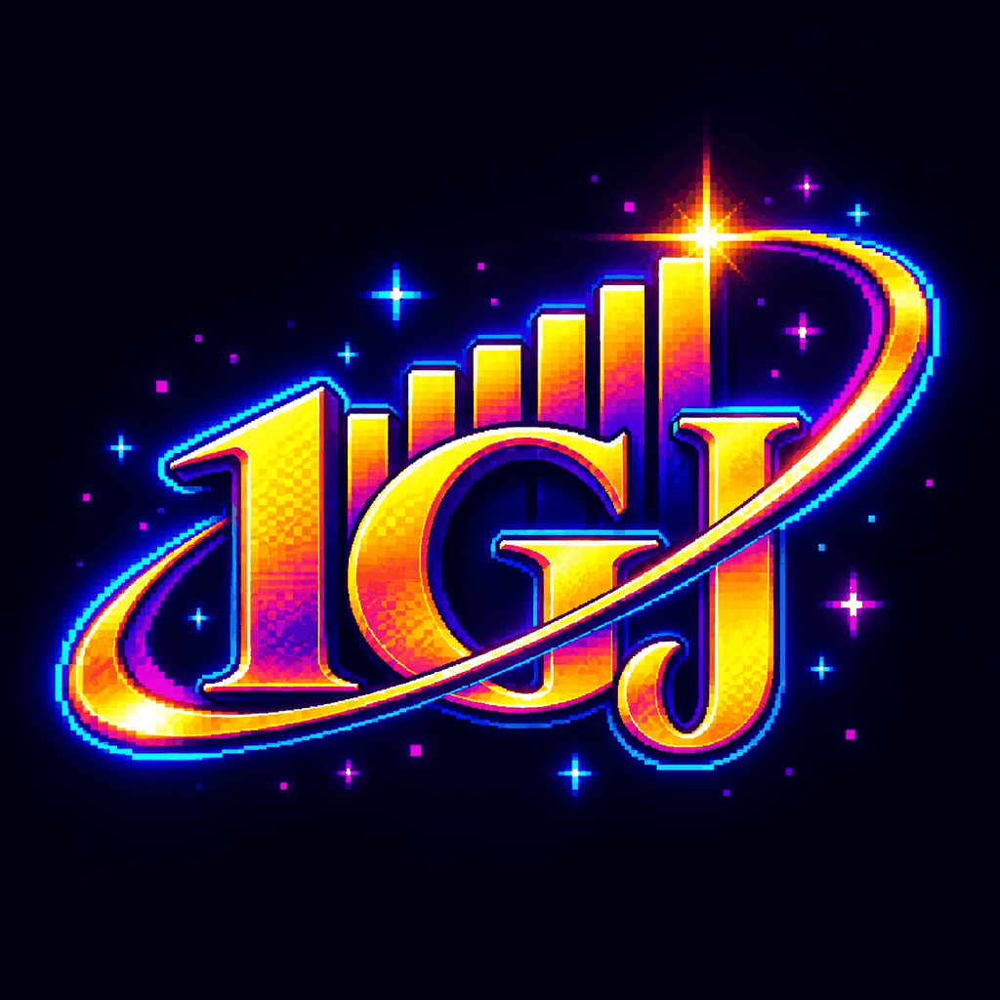
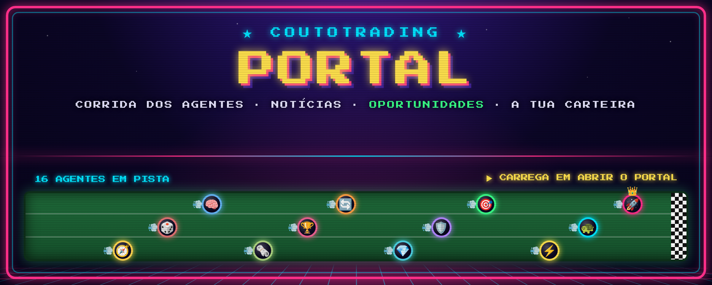
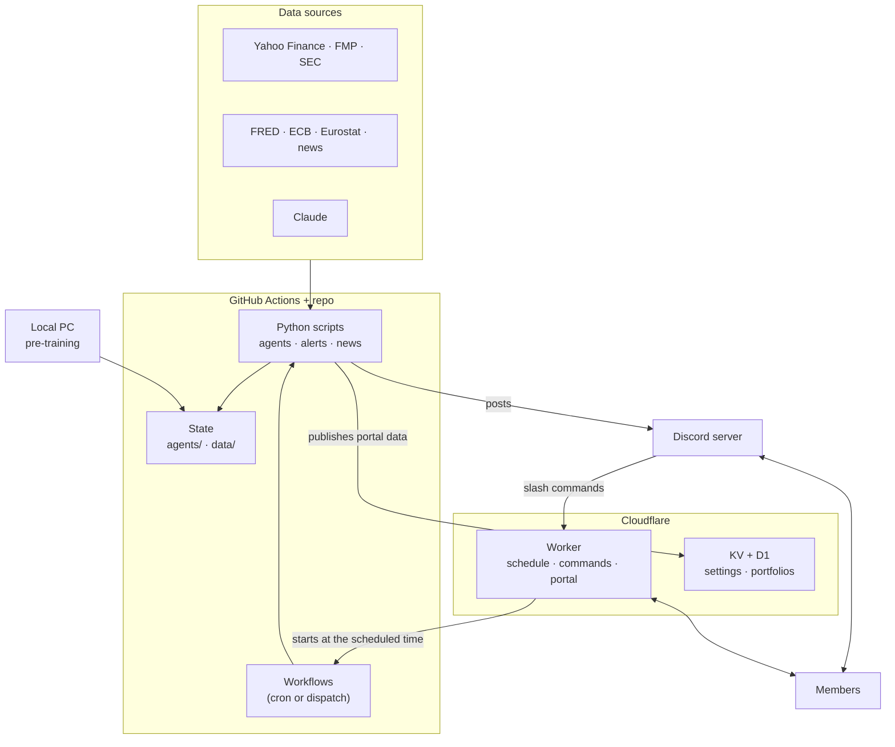

<p align="center">
  
</p>

<h1 align="center">One Guillion Jollars</h1>

<p align="center">
  <b>A Discord trading community run by a league of AI-trained agents.</b><br>
  Daily market tips, breakout alerts, news read by Claude, 22 paper-trading strategies trained on 20 years of data,<br>
  and a portal where every member tracks their own portfolio.
</p>

<p align="center">
  <a href="https://github.com/tigogggg/one-guillion-jollars/actions/workflows/tests.yml"></a>
  
  
  
  
  <br>
  
  
  
</p>

<p align="center">
  <a href="#-key-features">Features</a> &nbsp;&middot;&nbsp;
  <a href="#-what-members-can-do">Commands</a> &nbsp;&middot;&nbsp;
  <a href="#-the-agents">Agents</a> &nbsp;&middot;&nbsp;
  <a href="#-how-it-works">Architecture</a> &nbsp;&middot;&nbsp;
  <a href="#-quick-start">Quick start</a> &nbsp;&middot;&nbsp;
  <a href="#-roadmap">Roadmap</a> &nbsp;&middot;&nbsp;
  <a href="docs/TECHNICAL.md">Technical reference</a>
</p>

<p align="center">
  
</p>

---

## ✨ Key features

<div align="center">
<table width="94%">
  <tr>
    <td width="50%" valign="top">
      <h3>🏁 Agents league</h3>
      • 22 strategies trade virtual euros on real prices<br>
      • S&amp;P 500, UCITS ETFs and ~330 large European stocks<br>
      • Real costs, currency conversion, stamp duties and 28% tax<br>
      • Every trade explained with the numbers behind it
    </td>
    <td width="50%" valign="top">
      <h3>🧪 20-year pre-training</h3>
      • Walk-forward backtest with the live engine<br>
      • Point-in-time S&amp;P 500, SEC fundamentals and macro data<br>
      • Crash tests (2008, 2011, 2020, 2022), exam year, Monte Carlo<br>
      • Claude proposes parameters; the backtest decides
    </td>
  </tr>
  <tr>
    <td width="50%" valign="top">
      <h3>🎯 Opportunities and alerts</h3>
      • Buy / watch / sell lists with a 0-100 safety score<br>
      • Breakouts on volume, VCP setups and sector leaders<br>
      • Intraday alerts with follow-ups after 5 and 20 sessions<br>
      • Earnings dates and macro events flagged before they hit
    </td>
    <td width="50%" valign="top">
      <h3>🏟️ Portal and personal portfolio</h3>
      • The agents' race, news, proposals, calendar and glossary<br>
      • Your own portfolio with live quotes and a Keep / Reduce / Sell verdict<br>
      • XTB import, sign-in with Discord or Google, installable as an app<br>
      • On-demand portfolio analysis by Claude
    </td>
  </tr>
  <tr>
    <td width="50%" valign="top">
      <h3>📰 News that matters</h3>
      • Headlines rated by Claude (FinBERT as fallback)<br>
      • Sentiment, importance and surprise per stock<br>
      • Price reaction measured 1 and 5 sessions later<br>
      • Geopolitical risk score read from the day's news
    </td>
    <td width="50%" valign="top">
      <h3>🌍 Market context</h3>
      • VIX, policy uncertainty, credit stress, rates, dollar<br>
      • Geopolitical Risk index, oil, gold, sector health<br>
      • Inflation and deposit-rate lines on every long chart<br>
      • The same data live and across 20 years of backtest
    </td>
  </tr>
</table>
</div>

## 💡 What is One Guillion Jollars?

One Guillion Jollars is a Portuguese-speaking Discord community for learning to invest with discipline. A bot posts the market reading every weekday, finds setups and alerts members when a stock breaks out. A league of simulated agents shows, in public and with real costs, which strategies actually work.

Nothing here places real orders. The agents trade virtual money, and every list shows the rules behind it, so members can judge for themselves. *Ferramenta educativa: nada aqui é recomendação de compra.*

---

## 💬 What members can do

| Command | What it does |
|---|---|
| `/acao NVDA` | Trend, quality, pivot and stop for a US stock |
| `/etf VWCE` | Trend of a UCITS ETF |
| `/mercado` | The market reading right now |
| `/posicao 10000 35.84 34.14` | How many shares to buy for a given capital, entry and stop |
| `/agentes [nome]` | The agents league, or one agent's card |
| `/estrategia nome` | How an agent thinks: rules, parameters, pre-training and results |
| `/prontidao` | Which agents have earned trust (5 criteria) |
| `/portal` | Link to the portal |
| `/carteira` | Your private portfolio: record buys and sells and follow performance |
| `/seguir adicionar NVDA` | Your personal watchlist, with private-message alerts |
| `/limites` | Health of the data sources and the limits used (Claude, FMP, GitHub) |
| `/horario`, `/agente` | Schedules and agent management (admins only) |

**What arrives in the channels, without asking:**

| When | Channel | Post |
|---|---|---|
| Every weekday morning | 📊 mercado | Tips of the day, market breadth, sector rankings, macro agenda |
| Weekdays, 3 times | 🚨 alertas e notícias | Breakouts on volume, and the news that matters |
| Every weekday | 🤖 agentes | The league: each agent's orders, results and the race |
| Every weekday evening | 🚨 alertas e notícias, 🔧 estado | Alert follow-ups and the bot's health check |
| Saturday | 📊 mercado | Weekly summary, with how the alerts did |
| After each update | 📢 novidades | What is new on the platform, written by Claude |

---

## 🤖 The agents

Each agent starts with virtual euros and follows one strategy. Its parameters are chosen by the pre-training, and it is scored every day against the S&P 500.

| Style | Strategies |
|---|---|
| **Benchmark and ETFs** | Indexador (S&P 500 buy and hold) · Guardião (world ETF sized by market zone) · Rotador (best UCITS ETFs) · Pêndulo (dual momentum: stocks, bonds or gold) |
| **Trend and momentum** | Foguetão (top trend scores) · Campeão Setorial (best stocks of the strongest sectors) · Kamikaze (the 2 biggest 3-month gainers) |
| **Setups** | Caçador (breakouts on volume) · Sniper (volatility contraction, VCP) · Pescador de Quedas (pullbacks in uptrends) · Relâmpago (opening-range breakout, intraday) |
| **Fundamentals** | Joalheiro (top ranking with high quality) · Analista (solid, fairly priced companies) · Quant (multi-factor with trained weights) · Monge (low volatility) · Abutre (solid companies recovering from a fall) |
| **News** | Jornalista (news rated by Claude) · Deriva (post-news gaps on volume) · Catalisador (good news confirmed by price) · Cético (bad news the market ignored) |
| **Meta-agents** | Conselho (what several agents support) · Maestro (copies the best agents in the current market regime) |

**How a strategy earns its parameters.** A new parameter set replaces the current one only if it:

1. beats the current set in most of the training years;
2. does not fall deeper in the 2008, 2011, 2020 and 2022 crises;
3. holds up on the exam year it never saw;
4. has no clearly higher Monte Carlo risk of ruin;
5. survives a plateau test (nearby values must keep most of the score).

Each agent also runs paper "shadow" copies with mutated parameters, and a copy that clearly beats its agent live is promoted. `/prontidao` shows which agents pass the five checks for trust: enough live sessions, beating the Indexador, staying within the backtest's worst case, enough trades and a limited drawdown.

---

## 🏗 How it works



- **The Worker keeps the schedule.** A Cloudflare cron checks every 5 minutes and starts the right GitHub workflow at the times admins set with `/horario` (Lisbon time). It also answers slash commands and serves the portal behind a Discord or Google sign-in.
- **GitHub Actions does the work.** Each workflow runs a Python script that loads the data, decides, posts to Discord, publishes the portal's data to KV and commits state back to git.
- **Heavy training runs locally.** `train_local.py` uses every core the machine has, for free, and pushes the new parameters.

See the [technical reference](docs/TECHNICAL.md) for every rule, schedule and data source.

---

## 🚀 Quick start

For contributors. You need [uv](https://docs.astral.sh/uv/) and git.

```bash
git clone https://github.com/tigogggg/one-guillion-jollars
cd one-guillion-jollars
uv sync
uv run pytest -q tests
```

Preview any post without sending it (charts go to `reports/preview/`):

```bash
uv run python scripts/discord_daily.py --dry-run
```

Train the agents on your own machine and push the result:

```bash
uv run python scripts/train_local.py --ate-convergir --push
```

Running the bot itself needs a Discord application, a Cloudflare Worker and the GitHub secrets listed in the [setup guide](docs/TECHNICAL.md#discord-bot-slash-commands). Secrets live only in GitHub Actions and Cloudflare, never in the code.

---

## 🧰 Tech stack

| Layer | Technology |
|---|---|
| Analysis and agents | Python 3.11, pandas, uv, yfinance, SEC XBRL, FRED, ECB, Eurostat |
| AI | Claude (news, agent reviews, portfolio analysis, update notes), FinBERT fallback |
| Scheduling and compute | GitHub Actions, plus local training on any PC |
| Site and bot | Cloudflare Workers, KV, D1, Discord interactions, Plotly |
| Trading skills | [tradermonty/claude-trading-skills](https://github.com/tradermonty/claude-trading-skills) (MIT) |

## 📁 Project structure

```
discord-bot/        Cloudflare Worker: slash commands, schedule, portal, portfolios, sign-in
scripts/            Python: agents, pre-training, opportunities, news, alerts, context, posts
skills/             Claude Code trading skills (breadth, uptrend, VCP, position sizing, ...)
.github/workflows/  One workflow per job: tips, alerts, news, agents, training, deploys
data/               Market context, fundamentals, universe and earnings history
discord/            Channel ids, banner and logo
docs/               Technical reference
tests/              pytest suite (runs on every pull request)
```

---

## 🗺 Roadmap

Ideas under discussion, not commitments:

- [ ] **Members league:** every member gets virtual euros and competes with the agents, with monthly seasons
- [ ] **Build your own agent:** choose a strategy, risk and filters and enter it in the league
- [ ] **Follow an agent:** a private message for every trade of the agent you follow
- [ ] **More markets:** forex, crypto and commodities, and Euronext / PSI stocks with the same alerts
- [ ] **No-code backtests:** test simple rules over 20 years from the portal
- [ ] **Themed tournaments:** short contests with fixed rules (only ETFs, only Europe, at most 3 positions)

---

## ⚠️ Disclaimer

This project is for education and research. It does not give investment advice and does not place real orders; the agents trade virtual money. Past and simulated results do not guarantee future returns. Every decision is yours.

*Ferramenta educativa. Nada aqui é recomendação de compra; as decisões são tuas.*

## 🙏 Credits

The trading skills in `skills/` come from [tradermonty/claude-trading-skills](https://github.com/tradermonty/claude-trading-skills) under the MIT license (see [`LICENSE-claude-trading-skills`](LICENSE-claude-trading-skills)). The portal font is Press Start 2P (SIL OFL). Market data comes from Yahoo Finance, FMP, the SEC, FRED, the ECB and Eurostat under their own terms.
